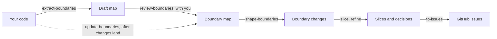

# Boundary model

Agent skills that give a coding agent a map of your system as the people and systems using it see it: who uses it, for what, and through which interfaces. The agent builds the map from your code, keeps it current, and uses it with you to explore and propose changes before any code is written.


*An example map, drawn by `visualize-boundaries`: an online store, opened one level.*

## Why

A coding agent sees a repository as files, folders and functions, so it plans changes in those terms: which files to edit. What a change means for the people and systems that use the code, and which part of the system should own it, stays implicit until code review, when it costs the most to change.

The boundary model describes a system one level up, from its consumers' side: the resources they care about, what they can do with them, and through which interfaces. Opening a provider shows the components it relies on, each with the state it keeps and the decisions it makes. That is where you and the agent decide what a change is and which part should own it.

These skills give the agent that map and a way to work with it alongside you. The agent builds the map from the code and reviews it with you, keeps it up to date as the code changes, and shapes each change as the boundary changes it leads to, before the change is sliced into work.

## Principles

- **Consumers first.** A boundary says what its consumer gets: resources, capabilities and interfaces. How the provider is built appears only when you open it, one level down.
- **The code decides what exists.** Documents give intent and vocabulary. The agent checks every boundary against the code and cites the files behind it.
- **People decide what it means.** You settle the names, what matters and whether the map reads clearly. A map is finished once a person has reviewed it.
- **One map, kept current.** The map describes one revision of the code. An update reads only what changed since, so the decisions from earlier reviews stay.
- **Shape before building.** A change is first stated as the boundary changes it leads to, which sets its scope. Slicing it into work, settling its details and writing issues come after.

## Shaping a change

Ask the agent to shape a change, such as "let shoppers pay with gift cards". It asks you questions until no answer could add, remove or redefine a boundary change, then proposes the shape for you to confirm:

```markdown
Resources of Store:

- NEW **Gift card**: a prepaid amount a shopper can spend in the shop

**Shopper <-> Store**: MODIFIED, shoppers can pay with a gift card and see what is left on it

- Interfaces: web shop · mobile app
- Shop (core)
  - MODIFIED Place order: produces **Order** · mutates **Loyalty balance** · mutates **Gift card**
- See gift card balance (supporting)
  - NEW See gift card balance: observes **Gift card**

Resources of Payments:

- NEW **Gift card**: a prepaid amount a shopper can spend in the shop

**Storefront <-> Payments**: MODIFIED, Payments charges an order to a gift card as well as to a card

- Interfaces: charges API
- Charge orders (core)
  - MODIFIED Charge order: produces **Charge** · mutates **Gift card**

**Shape complete: YES**

**Open**

- None

**Details**

- Can a gift card pay for part of an order, with a card paying the rest? — About: Place order, Charge order
```

The shape says what changes for each consumer, marked NEW, MODIFIED or REMOVED against the map, and which component keeps the new resource. How to build it comes later: `slice` splits it into pieces of work, `refine` settles the details, and `to-issues` writes the issues.

## Install

Install all nine skills. The map scripts find `use-boundary-model` in the folder next to theirs, so the skills must sit side by side.

### With npx skills

```bash
npx skills add meaningfool/boundary-model --skill '*'
```

It supports Claude Code, Codex, and most other agents.

- `-a <agent>` picks an agent, such as `-a claude-code -a codex`.
- `-y` skips the confirmation prompts.
- `-g` installs for your user instead of the current project.

In a project, the skills go in `.agents/skills/`, linked into each agent's own folder such as `.claude/skills/`, and `skills-lock.json` records the version. To update, run `npx skills update`. To remove, run `npx skills remove --all`.

### In Claude Code

```text
/plugin marketplace add meaningfool/boundary-model
/plugin install boundary-model@meaningfool
```

From a shell, run `claude plugin marketplace add meaningfool/boundary-model`, then `claude plugin install boundary-model@meaningfool`.

Auto-update is off by default for this marketplace. To update, run `claude plugin update boundary-model@meaningfool`, or turn on auto-update for `meaningfool` on the Marketplaces tab of `/plugin`.

### In Codex

```bash
codex plugin marketplace add meaningfool/boundary-model
codex plugin add boundary-model@meaningfool
```

Start a new session to use the skills. To fetch a newer version of the marketplace, run `codex plugin marketplace upgrade meaningfool`. To remove, run `codex plugin remove boundary-model@meaningfool`.

Both plugins install the nine skills as one plugin, so each skill's name becomes `boundary-model:<skill>`, such as `boundary-model:extract-boundaries`.

### By hand

```bash
git clone https://github.com/meaningfool/boundary-model.git
cd boundary-model/skills
mkdir -p ~/.claude/skills
cp -R use-boundary-model extract-boundaries review-boundaries \
  update-boundaries visualize-boundaries shape-boundaries \
  slice refine to-issues ~/.claude/skills/
```

These commands install for Claude Code. For another agent, use its skills folder in the last two commands, such as `~/.agents/skills/` for Codex. To share the skills with a team, use the project's skills folder instead.

Keep the folder names, and name each folder as above. Don't copy with a trailing-slash glob such as `skills/*/`. On macOS, `cp -R` with a trailing slash copies a folder's contents instead of the folder.

## What the skills need

- Node 18 or later, for the map scripts.
- Chrome, Chromium, or Edge, for still images of a map. Without one, `visualize-boundaries` still draws the map as a page. Set `CHROME_PATH` if the script cannot find the browser.
- Access to GitHub, for `to-issues` to create issues.

## Where to start



- Nothing built yet: `shape-boundaries`.
- Code, but no boundary map: `extract-boundaries`.
- Code with a boundary map: `update-boundaries` to bring the map up to date, or `shape-boundaries` to plan a change.
- No boundary model wanted: `slice`, `refine`, and `to-issues`, on their own.

`extract-boundaries` ends by offering a review with `review-boundaries`. It writes the map at its location only after that review, unless you ask otherwise. `update-boundaries` ends with the review. So the map at its location is one a person has reviewed.

`shape-boundaries` starts from the map when there is one. It reads the code behind the boundaries the change touches rather than trusting the map.

The skills keep the map at `docs/boundary-map.json` by default. Ask the agent in plain words, such as "map this repository's boundaries", or name the skill.

## Skills

- `use-boundary-model`: defines the model, its vocabulary, and the boundary map's format, schema, and checker.
- `extract-boundaries`: maps an existing system's boundaries from its repository, then offers a review.
- `review-boundaries`: walks a person through a map, level by level, with still images and short questions, then writes the reviewed map.
- `update-boundaries`: brings a map up to date with what changed since its revision, then reviews it.
- `visualize-boundaries`: checks a map and draws it as a page or as still images, at every level or at Level 1 alone, optionally marking what changed since an earlier map.
- `shape-boundaries`: expresses a change as the boundary changes it leads to.
- `slice`: compares ways to divide a change into pieces of work.
- `refine`: settles a change's expected behavior and design decisions.
- `to-issues`: publishes slices or changes as GitHub issues, each with its proof of done.

## Licence

MIT. See [LICENSE](LICENSE).
